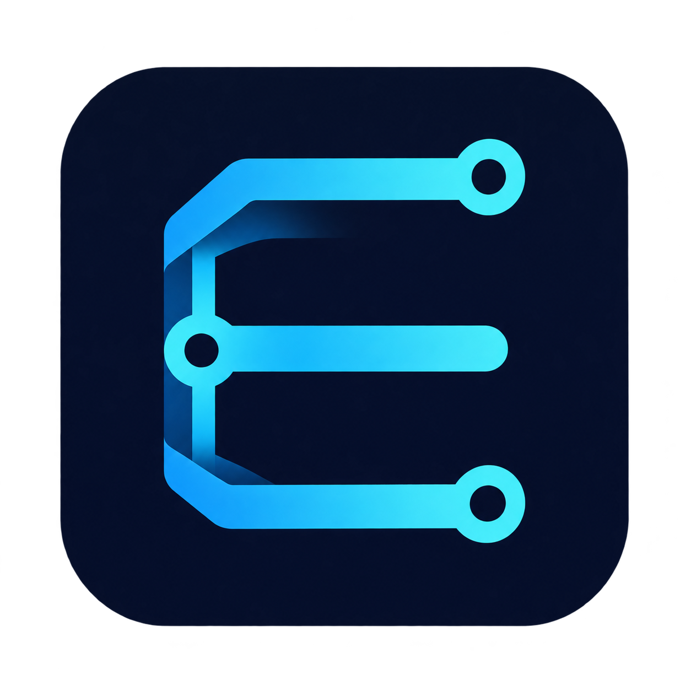
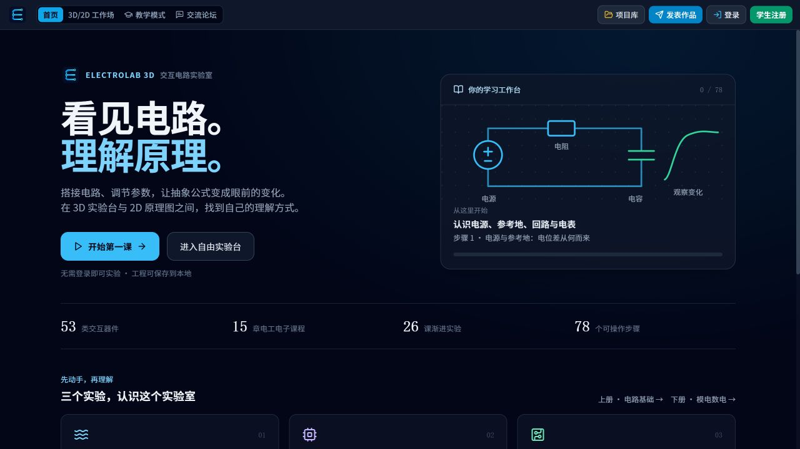

<p align="center">
  
</p>

<h1 align="center">ElectroLab 3D</h1>
<p align="center"><strong>看见电路。理解原理。</strong></p>
<p align="center">3D / 2D 联动仿真 · 实时示波器 · 电工电子交互教学</p>
<p align="center">
  <a href="https://github.com/lanxinge/ElectroLab-3D/archive/refs/heads/main.zip">下载源码</a> ·
  <a href="docs/使用指南.md">使用指南</a> ·
  <a href="docs/品牌标识.md">Logo 与品牌文件</a> ·
  <a href="docs/ai-prompts/README.md">AI 开发 Prompt 与迭代记录</a>
</p>



## 这是什么

面向电工电子学习者的交互实验室。拖动元件、连接引脚、调节参数，观察电压、电流与波形，再打开元件的原理演示理解变化。

- **53 类器件与功能模块**：模拟、数字、测量、时序和自定义芯片。
- **15 章、26 课、78 个教学步骤**：从电路基础，到 RC、NE555、ADC / DAC 与混合信号实验。
- **同一电路，多种视角**：3D、2D 原理图和示波器共享实验状态，纯 2D 模式也持续仿真。
- **解释当前元件**：将实际参数、读数与原理推导关联起来。
- **保存与复用**：本地工程、账号项目、真值芯片、嵌套封装和社区作品。

## 一键启动

先安装 [Node.js 24](https://nodejs.org/)（包含 npm），下载并解压源码。

### Windows

双击根目录的 **`start.cmd`**。

### macOS / Linux

在项目目录执行：

```sh
sh start.sh
```

脚本会检查环境、在首次运行时安装依赖、自动构建、创建本机配置，并在服务就绪后打开浏览器。后续运行会复用已有依赖与构建；代码或配置更新时自动重新构建。

默认网址为 **http://127.0.0.1:3001**。保持启动窗口运行，按 `Ctrl+C` 停止。

所有平台也可使用：

```sh
npm run launch
```

### 启动选项

```sh
npm run launch -- --port 3002       # 指定端口
npm run launch -- --no-open         # 只启动服务
npm run launch -- --rebuild         # 强制重新构建
npm run launch -- --setup-only      # 只安装并构建
```

Windows 也可直接运行 `start.cmd --port 3002`，macOS / Linux 使用 `sh start.sh --port 3002`。

## 推荐体验路线

1. **第一课**：调节电源电压，认识参考地与电表。
2. **RC 换路**：暂停、切换、单步，观察电压连续与电流反向。
3. **NE555**：重复触发脉冲，比较理论频率与实测周期。
4. **DAC**：输入二进制码，再让计数器生成阶梯波。
5. **自由设计**：把教学电路带到工作台，封装模块，导出自己的工程。

核心实验无需登录。登录后可以把工程与芯片保存在当前部署的服务中。

## 开发与手动运行

```sh
npm ci
npm run dev        # 前端 5173，API 3001
```

```sh
npm run build
npm start          # 正式运行模式，端口 3001
npm test           # 仿真、教学、工程流程与 API 测试
```

一键脚本自动读取根目录 `.env`，配置项示例见 [.env.example](.env.example)。首次启动会生成并保存本机签名配置；项目数据默认保存在 `data/electrolab.sqlite`。

手动运行并加载 `.env` 时可使用：

```sh
node --env-file=.env --no-warnings --import tsx server/start.ts
```

| 配置 | 用途 | 默认值 |
|---|---|---|
| `PORT` | 服务端口 | `3001` |
| `DB_PATH` | SQLite 文件 | `data/electrolab.sqlite` |
| `JWT_SECRET` | 接口令牌签名 | 一键脚本自动生成并保存 |

## 版本与实现

`v1.0` 标签保留参赛功能基线 `65f2114`；`main` 包含后续品牌资源、文档和便捷启动更新。

React / Three.js / SVG / Canvas 提供交互与展示，Zustand 管理共享状态；独立仿真循环驱动节点求解与混合逻辑。Express 和 SQLite 保存账号与工程数据。

核心实现位于 `src/engine`，课程位于 `src/tutorial`，界面与状态位于 `src/components`、`src/store`，服务位于 `server`。

## AI 协作开发记录

[开发记录索引](docs/ai-prompts/README.md)整理了 Antigravity 的 13 条用户 Prompt 与完整可见回复、三条核心迭代链路，以及 Codex 的评估和 v1.0 修复记录，并关联对应的 Git 提交。

仓库协作与 Git 管理规则见 [AGENTS.md](AGENTS.md)。
